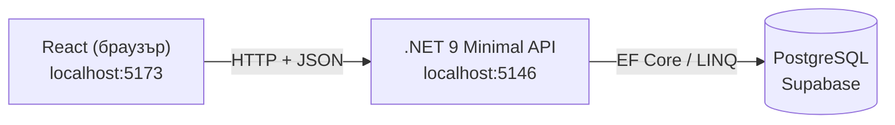

# Workout & PR Tracker

Уеб приложение за дневник на тренировките: записваш серии (тежест и повторения), виждаш кога подобряваш личен рекорд (PR) и следиш прогреса си с графики.

Проектът представлява **full-stack проект** (React + .NET + PostgreSQL).

## Снимки на приложението

[Екран на приложението](docs/screenshots/1.png)

[Записване на тренировка](docs/screenshots/2.png)

[Добавяне на ново упражнение](docs/screenshots/3.png)

[Шаблон за попълване на график](docs/screenshots/4.png)

[Попълнен график](docs/screenshots/5.png)

[Наличие на график](docs/screenshots/6.png)

[Предупреждение при триене на график](docs/screenshots/7.png)

[История](docs/screenshots/8.png)

[Предупреждение при триене на история](docs/screenshots/9.png)

[Прогрес (1RM)](docs/screenshots/10.png)

[Прогрес (Тежест)](docs/screenshots/11.png)


## Функции

- **Тренировка:** избираш упражнение от каталог (търсене, филтър по мускулна група) или зареждаш **график**. Всяко упражнение има свой блок за серии и бадж **NEW PR** при рекорд.
- **Каталог с упражнения:** можеш да добавиш свое упражнение със свободен текст и една или няколко мускулни групи (първата е **главната**).
- **График:** шаблон от упражнения за многократно ползване (например "Гърди и гръб"). Създава се, редактира се и се трие в отделен таб.
- **История:** всички записани тренировки; изтриване с потвърждение.
- **Прогрес:** графики на прогнозния 1RM (формула на Epley) и максималната тежест във времето; за упражнения без тежест (лицеви опори) се следят повторенията.

## Технологии

| Част | Технологии |
|---|---|
| Фронтенд | React 19, Vite, Tailwind CSS v4, Recharts, lucide-react |
| Бекенд | .NET 9 Minimal API, Entity Framework Core (LINQ), Npgsql |
| База данни | PostgreSQL (Supabase) |

## Архитектура



Браузърът никога не говори директно с базата. Само API-то знае connection string-а и проверява всичко, което получава.

## Структура

```
Workout-PR-Tracker/
├── frontend/            # React + Vite
│   └── src/
│       ├── components/  # екрани и части от интерфейса
│       ├── data/        # списък с мускулни групи
│       ├── utils/       # сметки за PR и 1RM
│       └── api.js       # всички заявки към API-то
├── backend/             # .NET API
│   ├── Program.cs       # ендпойнти
│   ├── AppDbContext.cs  # връзка клас ↔ таблица (EF Core)
│   ├── Models.cs        # класове-таблици
│   ├── Dtos.cs          # форми на данните към React
│   └── Stats.cs         # 1RM и точки за прогреса
├── database/
│   ├── schema.sql       # таблици
│   └── seed.sql         # начални упражнения
```

## Как да го пуснеш

Нужни са: [Node.js](https://nodejs.org) (LTS), [.NET SDK 9](https://dotnet.microsoft.com/download) и безплатен проект в [Supabase](https://supabase.com).

### 1. База данни

В Supabase → **SQL Editor** изпълни по ред съдържанието на `database/schema.sql`, после на `database/seed.sql`.

Свързването е през **Session pooler** (поддържа IPv4). Взимаш го от Supabase → **Connect**. Настройките за сигурност: *Data API* изключен, *RLS* включен.

### 2. Бекенд

```bash
cd backend
dotnet user-secrets set "ConnectionStrings:Supabase" "Host=<pooler-host>;Port=5432;Database=postgres;Username=postgres.<project-ref>;Password=<парола>;SSL Mode=Require"
dotnet run
```

Паролата стои в `user-secrets` на твоя компютър и **не влиза в Git**. API-то стартира на `http://localhost:5146`. Ако връзката даде грешка за сертификат, добави `;Trust Server Certificate=true`.

### 3. Фронтенд

```bash
cd frontend
npm install
npm run dev
```

Отвори `http://localhost:5173`.

## API

| Метод | Път | Какво прави |
|---|---|---|
| GET | `/api/exercises` | списък с упражнения |
| POST | `/api/exercises` | ново упражнение |
| GET | `/api/exercises/{id}/progress` | точки за графиката на упражнението |
| GET | `/api/workouts` | история |
| POST | `/api/workouts` | запис на тренировка (в транзакция) |
| DELETE | `/api/workouts/{id}` | изтриване на тренировка |
| GET | `/api/plans` | списък с графици |
| POST | `/api/plans` | нов график |
| PUT | `/api/plans/{id}` | редакция на график |
| DELETE | `/api/plans/{id}` | изтриване на график |

## Ограничения

Проектът за момента е еднопотребителски: няма вход с профил и всеки с достъп до API-то вижда същите данни. Няма автоматични тестове, а CORS е настроен само за локално разработване. Идеи за развитие: потребителски профили, тестове, публикуване онлайн.
